# Bài 3: Bảo mật mạng máy tính

Bài thực hành gồm hai phần, mỗi phần nằm trong một thư mục riêng:

| Thư mục | Nội dung | Sách |
|---|---|---|
| `secure-chat/` | Ứng dụng chat qua SSL/TLS: server đa luồng, hai phía xác minh chứng chỉ của nhau (mTLS), tin nhắn được mã hoá thêm bằng AES-256-CBC | 3.2 (trang 67–78) |
| `netrecon/` | Bộ công cụ trinh sát mạng: quét cổng, nhận dạng dịch vụ (Nmap), lấy banner, sơ đồ mạng (ARP), tra lỗ hổng theo cổng; dùng qua CLI hoặc web Flask, có gửi kết quả qua email | 3.4 (trang 80–93) |
| `images/` | Ảnh chụp kết quả chạy thực tế | |

## Môi trường

| Thành phần | Phiên bản |
|---|---|
| Hệ điều hành | Windows 11 |
| Python | 3.13, chạy trong venv `.venv` đặt ở thư mục gốc repo |
| Thư viện | `cryptography`, `flask`, `click`, `python-dotenv` |
| Công cụ ngoài | OpenSSL, Nmap (kèm Npcap) |

Hai công cụ ngoài phải có trong PATH (thêm xong thì khởi động lại VS Code):

- **OpenSSL**: cài Win64 OpenSSL Light (https://slproweb.com/products/Win32OpenSSL.html) rồi thêm
  `C:\Program Files\OpenSSL-Win64\bin` vào PATH. Nếu máy đã có Git for Windows thì có thể dùng luôn
  bản OpenSSL đi kèm ở `<thư mục cài Git>\mingw64\bin`; các ảnh trong bài dùng bản này.
- **Nmap**: tải ở https://nmap.org/download.html (cài kèm Npcap) rồi thêm `C:\Program Files (x86)\Nmap` vào PATH.
  Nmap chỉ cần cho chế độ `service` và `all` của `netrecon`.

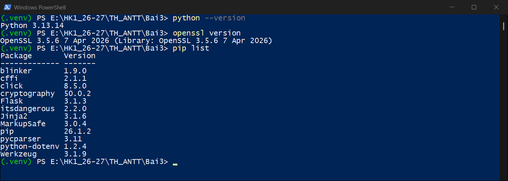

---

## 1. secure-chat

### 1.1 Cấu trúc

```
secure-chat/
├── openssl.cnf               # cấu hình Root CA (CA:true, keyCertSign, cRLSign)
├── make-certs.bat            # sinh CA, cert server (CN=localhost), cert client (CN=client)
├── message_encryption.py     # MessageEncryption: AES-256-CBC + PKCS7, output = IV (16 byte) | ciphertext
├── connection_manager.py     # ConnectionManager: socket -> {username, encryption_key}, có lock
├── room_manager.py           # RoomManager: tạo/vào/rời phòng, broadcast trong phòng
├── server.py                 # SecureChatServer: TLS 1.2+, bắt buộc client có cert do CA ký
└── client.py                 # SecureChatClient: xác minh cert server bằng ca.crt, gửi cert client
```

### 1.2 Luồng hoạt động

1. Client và server bắt tay TLS. Mỗi bên dùng `certs/ca/ca.crt` để kiểm tra chứng chỉ của bên kia (mutual TLS).
2. Client sinh ngẫu nhiên một khoá AES-256 và gửi `username:key_hex` cho server qua kênh TLS vừa lập.
3. Client mã hoá từng tin nhắn bằng AES trước khi gửi. Server giải mã bằng khoá của người gửi, sau đó
   mã hoá lại bằng khoá riêng của từng client nhận rồi chuyển tiếp.

### 1.3 Cách chạy

```powershell
.\.venv\Scripts\Activate.ps1        # từ thư mục gốc repo; đầu dòng sẽ hiện (.venv)
pip install cryptography
cd Bai3\secure-chat
.\make-certs.bat                    # sinh certs\ca, certs\server, certs\client

python server.py                    # terminal 1
python client.py                    # terminal 2, 3, ... (terminal nào cũng phải kích hoạt .venv)
```

`server.py` và `client.py` phải được chạy từ trong `secure-chat/`, vì đường dẫn `certs/...` trong code
là đường dẫn tương đối. Thư mục `certs/` nằm trong `.gitignore` nên khoá riêng không bị commit.

### 1.4 Kết quả

**Sinh chứng chỉ.** `make-certs.bat` tạo Root CA, sau đó ký chứng chỉ cho server (`CN=localhost`) và client (`CN=client`):

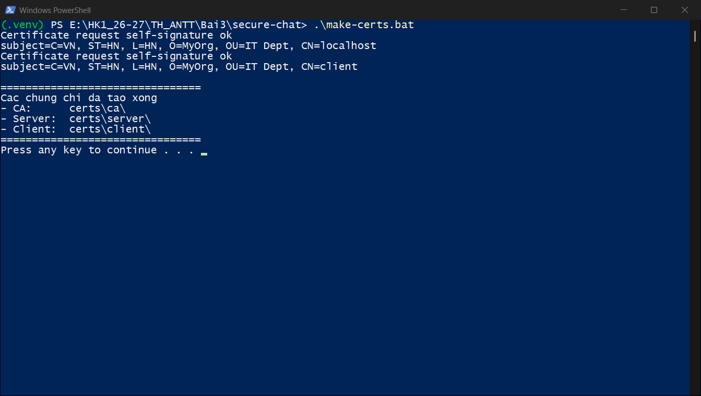

Mỗi thư mục con có khoá riêng `.key` và chứng chỉ `.crt`; server và client có thêm file yêu cầu ký `.csr`:

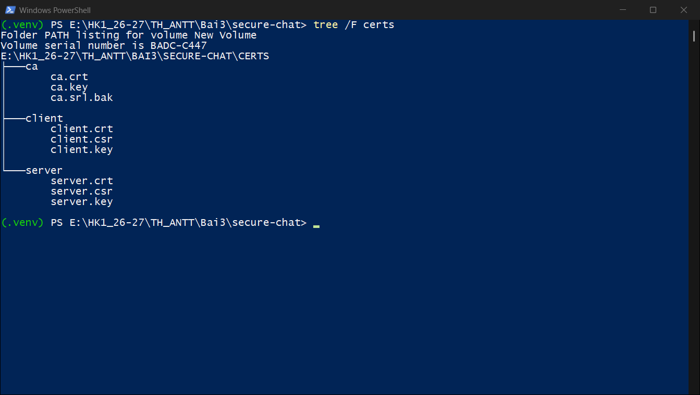

**Server.** Khi khởi động, server in `DeprecationWarning` cho `OP_NO_TLSv1*` (ảnh trong sách cũng có).
Sau đó nó ghi nhận từng client kết nối, in tin nhắn đã giải mã kèm tên người gửi, và báo khi client ngắt kết nối:

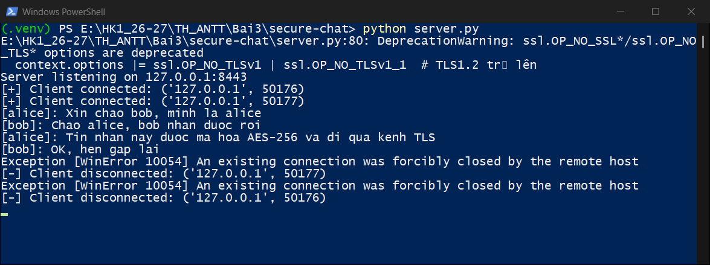

**Hai client chat với nhau.** Tin nhắn của `alice` hiện ở cửa sổ của `bob` kèm tên người gửi, và ngược lại:

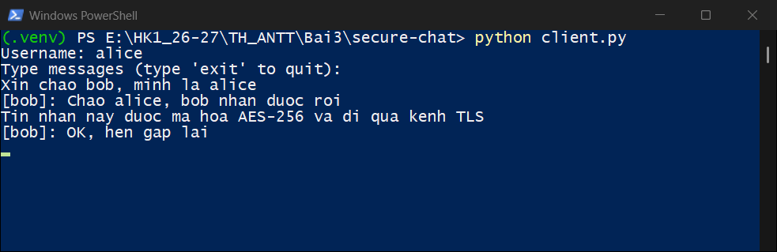
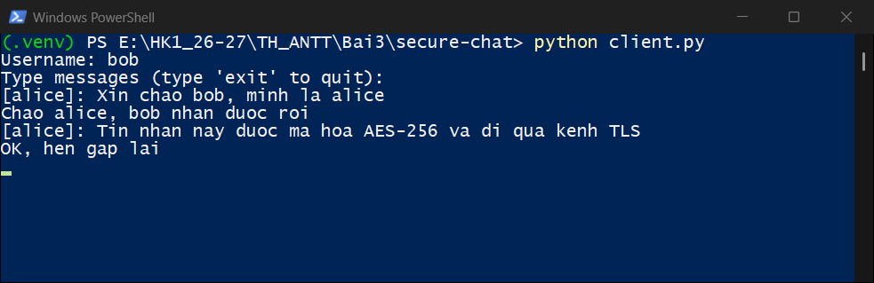

---

## 2. netrecon

### 2.1 Cấu trúc

```
netrecon/
├── modules/
│   ├── __init__.py
│   ├── port_scanner.py       # PortScanner: quét TCP connect bất đồng bộ, giới hạn đồng thời bằng Semaphore
│   ├── service_detector.py   # ServiceDetector: gọi `nmap -sV`
│   ├── banner_grabber.py     # BannerGrabber: kết nối, đọc 1024 byte đầu, timeout 2s
│   ├── network_mapper.py     # NetworkMapper: `arp -a`
│   ├── vuln_checker.py       # VulnChecker: tra bảng CVE theo số cổng
│   ├── filter_utils.py       # whitelist / blacklist IP
│   └── email_sender.py       # gửi kết quả qua Gmail SMTP (SSL 465)
├── templates/                # layout.html, index.html, result.html
├── static/style.css
├── cli.py                    # CLI (click)
├── app.py                    # web Flask, http://localhost:5000
├── requirements.txt
└── .env                      # SMTP_USER, SMTP_PASS (không commit)
```

Mọi hoạt động (cổng mở, kết quả Nmap, banner, ARP) được ghi kèm thời gian vào `netrecon.log`.

### 2.2 Cài đặt và chạy

```powershell
# (cần kích hoạt .venv như ở phần 1)
cd Bai3\netrecon
pip install flask click python-dotenv

# CLI
python cli.py --target scanme.nmap.org --ports 22,80 --mode scan
python cli.py --target scanme.nmap.org --ports 22,80,443 --mode all

# Web
python app.py                       # mở http://localhost:5000
```

| Tham số CLI | Ý nghĩa |
|---|---|
| `--target` | Máy cần quét (IP hoặc tên miền) |
| `--ports` | Danh sách cổng, cách nhau bằng dấu phẩy (mặc định `22,80,443`) |
| `--mode` | `scan` \| `service` \| `banner` \| `map` \| `vuln` \| `all` (mặc định `all`) |
| `--rate-limit` | Số kết nối đồng thời (mặc định 100) |

`requirements.txt` giữ nguyên như sách, nhưng không cần cài `asyncio` (đã có sẵn trong Python)
và `htmx` (là thư viện JavaScript, không phải gói Python).

> Chỉ quét máy của mình, mạng lab, hoặc `scanme.nmap.org` (Nmap cho phép quét thử máy này).

### 2.3 Cấu hình email

Muốn nhận kết quả qua email thì điền vào `.env` một tài khoản Gmail đã bật xác minh 2 bước, kèm
mật khẩu ứng dụng tạo ở https://myaccount.google.com/apppasswords:

```
SMTP_USER=email_cua_ban@gmail.com
SMTP_PASS=xxxx xxxx xxxx xxxx
```

Nếu để trống hoặc điền sai, app vẫn quét bình thường và chỉ in `[-] Email failed: ...` ra terminal.
`.env` và `netrecon.log` nằm trong `.gitignore`.

### 2.4 Kết quả CLI

**Chế độ `scan`.** Trong ba cổng được quét, cổng 22 và 80 của `scanme.nmap.org` đang mở:

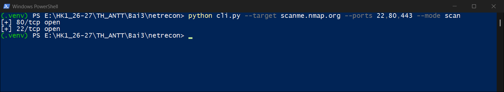

**Chế độ `banner` và `vuln`.** Cổng 22 trả về banner `SSH-2.0-OpenSSH_6.6.1p1`, cổng 80 và 443 báo `timed out`.
Chế độ `vuln` tra bảng CVE có sẵn theo số cổng, không gửi gói tin nào tới máy đích:

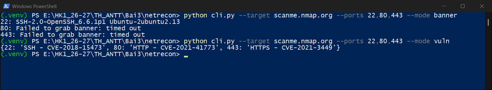

**File log.** Các lần quét trên được ghi lại trong `netrecon.log`:

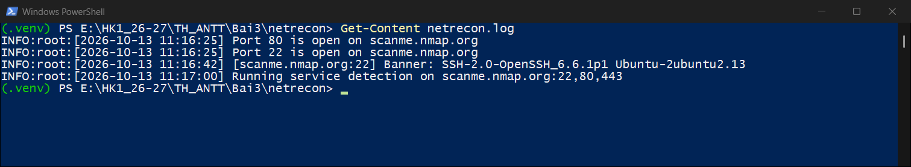

**Chế độ `service` và `all`.** Hai chế độ này gọi `nmap -sV`. Với `scanme.nmap.org`, Nmap nhận ra
OpenSSH 6.6.1p1 ở cổng 22 và Apache 2.4.7 ở cổng 80; chế độ `all` in thêm banner và bảng ARP của máy.
Nếu Nmap chưa có trong PATH, `cli.py` dừng với lỗi `FileNotFoundError: [WinError 2]`.

> Chưa có ảnh cho chế độ `service`/`all`: máy dùng để chụp chưa cài Nmap.

### 2.5 Kết quả web Flask

**Chạy server.** Terminal chỉ hiện hai dòng đầu; các dòng `Running on http://127.0.0.1:5000` của Flask
đi vào `netrecon.log`, vì các module đã gọi `logging.basicConfig(filename='netrecon.log')`:

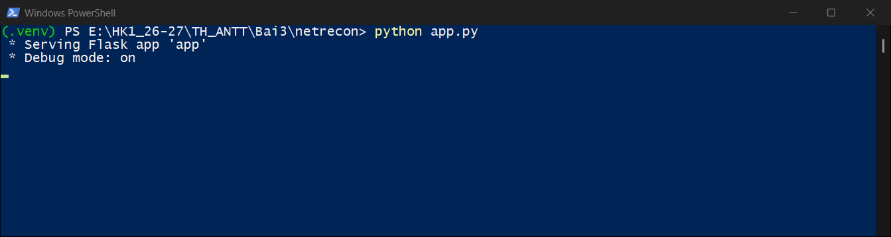

**Điền form** ở `http://localhost:5000`: máy đích, danh sách cổng, chế độ quét và email nhận kết quả:

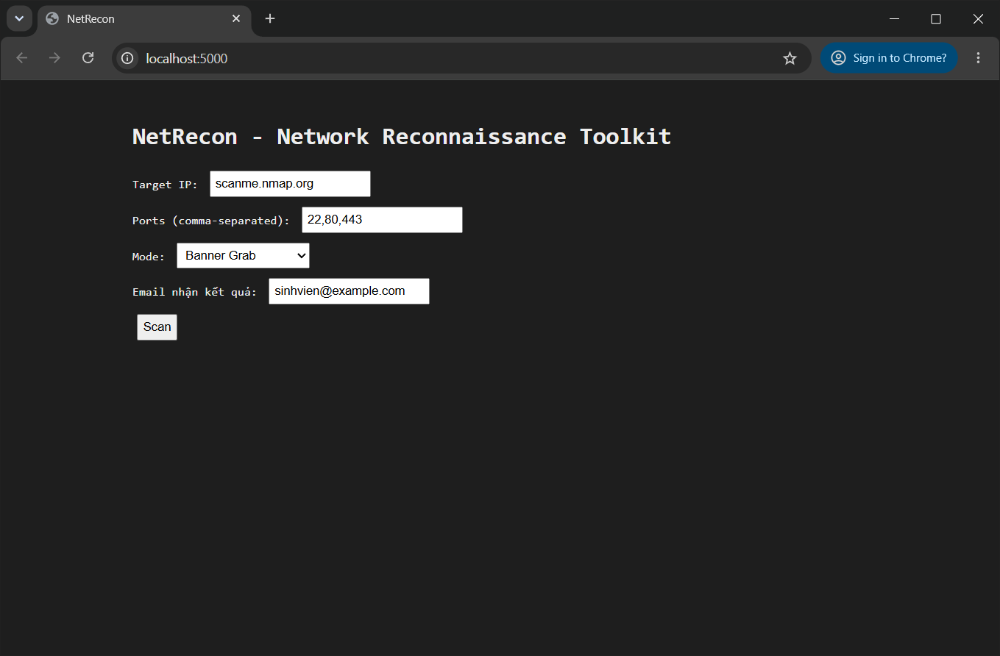

**Trang kết quả** (`/scan`) thay cho trang form sau khi bấm *Scan*:

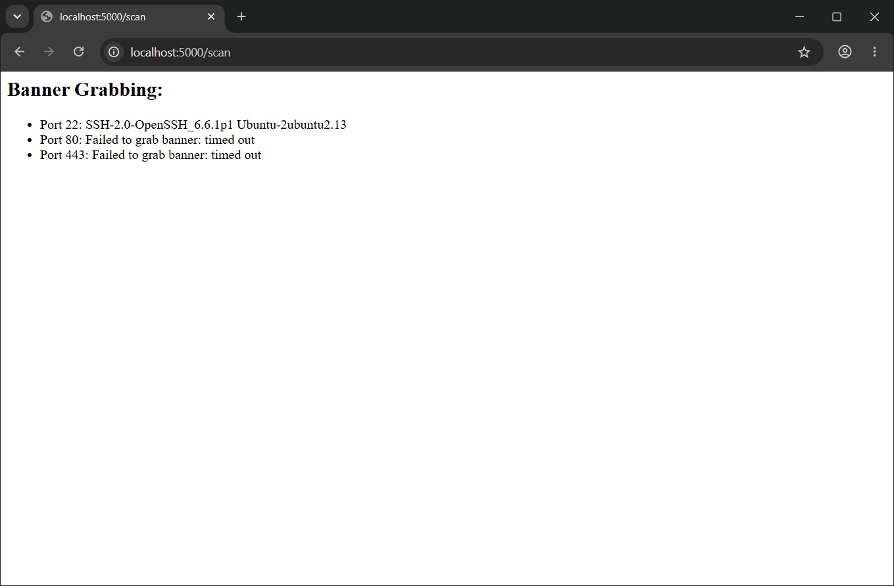

**Email.** Sau mỗi lần quét, app gửi nội dung kết quả tới địa chỉ đã nhập. Ảnh dưới chụp khi `.env` còn để
giá trị mẫu: việc quét vẫn hoàn tất, terminal chỉ báo gửi email thất bại:

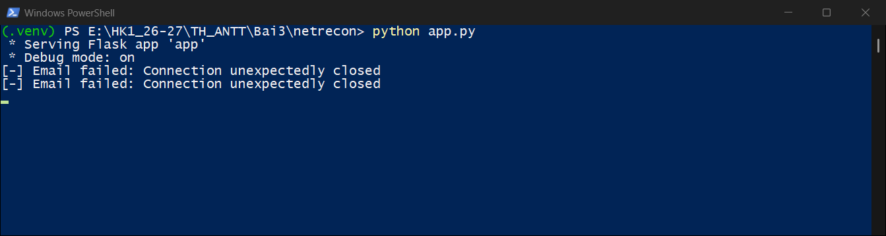

> Chưa có ảnh email trong hộp thư Gmail: cần điền tài khoản và mật khẩu ứng dụng thật vào `.env`.

---

## 3. Ghi chú so với code trong sách

Code giữ đúng như sách, chỉ khác ở ba chỗ:

- `make-certs.bat` theo bản ở trang 70, có `-config openssl.cnf`. Ảnh ở trang 71 thiếu tham số này,
  khi đó openssl sẽ hỏi từng trường thông tin thay vì đọc từ file cấu hình.
- `.env` để giá trị mẫu, không dùng email và mật khẩu in trong sách.
- `.gitignore` thêm `.env` (sách trang 89) và `netrecon.log` (log tự sinh khi chạy).

Một số hành vi của code gốc thấy được khi chạy:

- **Kết quả `scan` không được trả về.** `async_scan_ports` chỉ `print` cổng mở ra terminal mà không trả về gì,
  nên phần `SCAN` trong email luôn là `None` (ảnh email trong sách, trang 92, cũng vậy), còn trang web thì
  không hiện mục *Scan Result*.
- **Banner cổng 80/443 báo `timed out`.** Web server chờ client gửi request trước, nên chỉ đọc mà không gửi gì
  thì không nhận được banner. Cổng 22 thì khác: server SSH tự gửi banner ngay khi kết nối. Thỉnh thoảng
  `scanme.nmap.org` đóng kết nối SSH sớm và banner cổng 22 bị rỗng; chạy lại sau vài giây là được.
- **Server chat in `Exception [WinError 10054]` khi client gõ `exit`.** Client đóng socket mà không báo trước.
  Server vẫn dọn dẹp kết nối bình thường trong khối `finally`.
- **Form web gửi POST thông thường.** `index.html` có `hx-post`, nhưng `layout.html` không nạp thư viện htmx,
  nên trang kết quả thay cho trang form. `result.html` cũng không kế thừa `layout.html`, vì vậy trang kết quả
  không có CSS.
