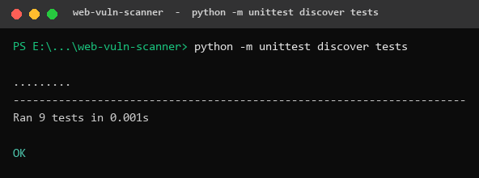
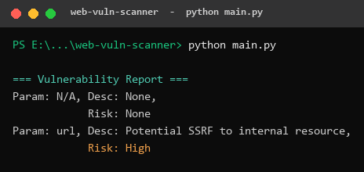
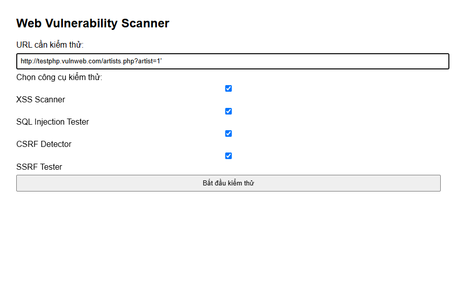
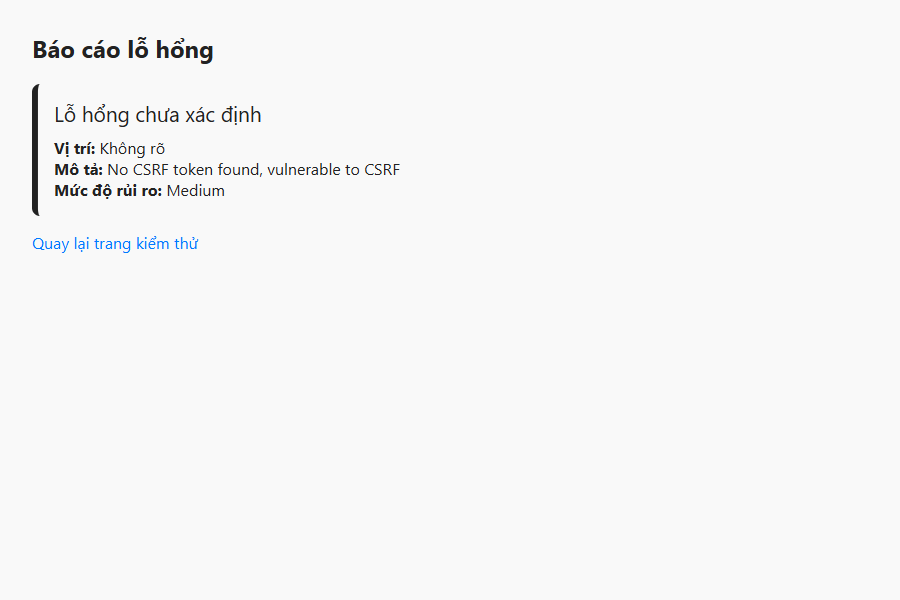
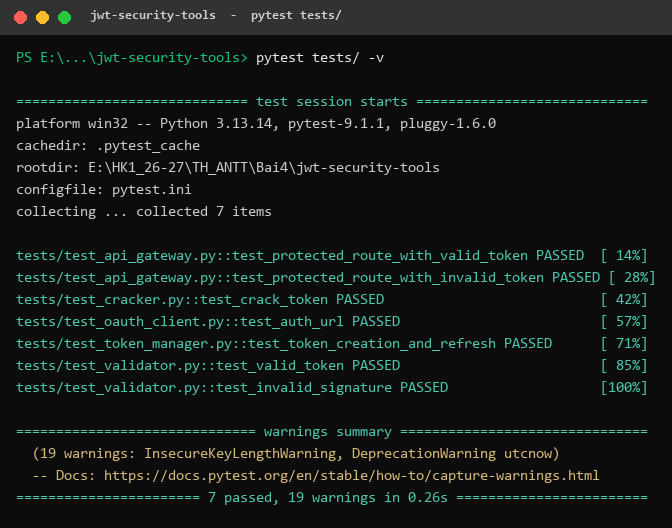
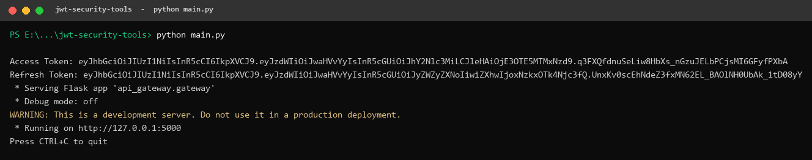
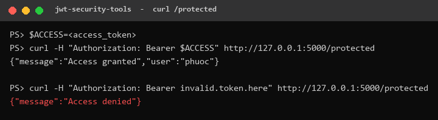

# BÁO CÁO THỰC HÀNH – BÀI 4: BẢO MẬT WEB APP VÀ API

**Môn học:** Lập trình an ninh thông tin

| Thông tin | Nội dung |
|-----------|----------|
| Họ và tên | *(điền họ tên)* |
| MSSV      | *(điền MSSV)* |
| Lớp       | *(điền lớp)* |
| Ngày thực hiện | 14/10/2026 |

Bài thực hành gồm hai công cụ được xây dựng bằng Python:

- **Bài 4.2 – `web-vuln-scanner`:** Công cụ quét lỗ hổng ứng dụng web (XSS, SQL Injection, CSRF, SSRF) kèm giao diện web bằng Flask.
- **Bài 4.4 – `jwt-security-tools`:** Bộ công cụ bảo mật JWT (kiểm tra token, dò khóa bí mật, OAuth client, quản lý vòng đời token và API Gateway bảo vệ bằng JWT).

---

## Mục lục

1. [Lý thuyết tóm tắt](#1-lý-thuyết-tóm-tắt)
   - [1.1. Lỗ hổng ứng dụng web](#11-lỗ-hổng-ứng-dụng-web)
   - [1.2. JSON Web Token (JWT)](#12-json-web-token-jwt)
   - [1.3. OAuth 2.0](#13-oauth-20)
2. [Bài 4.2 – WebVulnScanner](#2-bài-42--webvulnscanner)
   - [2.1. Mục tiêu & cấu trúc](#21-mục-tiêu--cấu-trúc-thư-mục)
   - [2.2. Vai trò từng module](#22-vai-trò-từng-module)
   - [2.3. Trích đoạn code quan trọng](#23-trích-đoạn-code-quan-trọng)
   - [2.4. Kết quả chạy](#24-kết-quả-chạy)
3. [Bài 4.4 – JWTSecure](#3-bài-44--jwtsecure)
   - [3.1. Mục tiêu & cấu trúc](#31-mục-tiêu--cấu-trúc-thư-mục)
   - [3.2. Vai trò từng thành phần](#32-vai-trò-từng-thành-phần)
   - [3.3. Trích đoạn code quan trọng](#33-trích-đoạn-code-quan-trọng)
   - [3.4. Kết quả chạy](#34-kết-quả-chạy)
4. [Hướng dẫn chạy lại](#4-hướng-dẫn-chạy-lại)
5. [Kết luận](#5-kết-luận)

---

## 1. Lý thuyết tóm tắt

### 1.1. Lỗ hổng ứng dụng web

#### a) Cross-Site Scripting (XSS)

XSS cho phép kẻ tấn công chèn và thực thi mã JavaScript tùy ý trong trình duyệt của nạn nhân, do ứng dụng xuất dữ liệu người dùng ra HTML mà không mã hóa (escape) đúng cách.

| Loại | Cơ chế |
|------|--------|
| **Reflected** | Payload nằm trong request (URL/tham số) và được phản hồi ngay trong trang trả về. |
| **Stored** | Payload được lưu vào CSDL (bình luận, hồ sơ...) rồi phát tán cho mọi người xem. |
| **DOM-based** | Lỗ hổng nằm ở JavaScript phía client thao tác DOM với dữ liệu không tin cậy, không cần máy chủ phản hồi lại payload. |

**Phòng chống:** mã hóa đầu ra theo ngữ cảnh (HTML/attribute/JS/URL encoding), kiểm tra đầu vào, dùng `Content-Security-Policy`, đặt cookie `HttpOnly`, dùng framework tự escape.

#### b) SQL Injection (SQLi)

Kẻ tấn công chèn cú pháp SQL vào tham số để làm sai lệch câu truy vấn, từ đó vượt xác thực, đọc/sửa/xóa dữ liệu. Các biến thể phổ biến:

- **Classic / In-band:** chèn trực tiếp như `' OR '1'='1`.
- **UNION-based:** dùng `UNION SELECT` để lấy dữ liệu từ bảng khác.
- **Error-based:** dựa vào thông báo lỗi để rút trích thông tin.
- **Blind (Boolean/Time-based):** không có kết quả trực tiếp, suy luận qua trạng thái đúng/sai hoặc độ trễ (`SLEEP`).
- **Stacked queries:** nối nhiều câu lệnh, ví dụ `'; DROP TABLE users;--`.

**Phòng chống:** dùng **prepared statements / parameterized queries**, ORM, kiểm tra kiểu dữ liệu, nguyên tắc tối thiểu quyền cho tài khoản DB, hạn chế lộ thông báo lỗi.

#### c) Cross-Site Request Forgery (CSRF)

Lợi dụng việc trình duyệt tự gửi kèm cookie phiên, kẻ tấn công lừa nạn nhân (đang đăng nhập) gửi một request thay đổi trạng thái mà họ không chủ ý (chuyển tiền, đổi mật khẩu...).

**Phòng chống:** dùng **anti-CSRF token** (token ngẫu nhiên mỗi phiên/biểu mẫu), thuộc tính cookie `SameSite`, kiểm tra header `Origin`/`Referer`, yêu cầu xác nhận lại với hành động nhạy cảm.

#### d) Server-Side Request Forgery (SSRF)

Ứng dụng nhận URL từ người dùng rồi tự gửi request đến URL đó. Kẻ tấn công ép máy chủ truy cập **tài nguyên nội bộ** (`127.0.0.1`, `localhost`, dải IP riêng `10.x`, `192.168.x`, `172.16–31.x`) hoặc metadata của cloud.

**Phòng chống:** dùng **allowlist** domain/IP hợp lệ, chặn dải IP nội bộ và loopback, không tin header do người dùng cung cấp, tách mạng, tắt redirect không cần thiết.

### 1.2. JSON Web Token (JWT)

JWT là chuỗi gồm **3 phần** ngăn cách bởi dấu chấm, mỗi phần mã hóa Base64Url:

```
Header . Payload . Signature
eyJhbGci... . eyJzdWIi... . q3FXQfdn...
```

- **Header:** thuật toán ký và loại token, ví dụ `{"alg":"HS256","typ":"JWT"}`.
- **Payload:** các *claim* (dữ liệu), ví dụ `sub` (chủ thể), `exp` (hết hạn), `type`...
- **Signature:** chữ ký để xác thực tính toàn vẹn: `HMACSHA256(base64(header) + "." + base64(payload), secret)`.

**Các lỗ hổng phổ biến:**

| Lỗ hổng | Mô tả |
|---------|-------|
| `alg: none` | Server chấp nhận token không có chữ ký ⇒ giả mạo tùy ý. |
| **Key confusion** (RS256→HS256) | Dùng public key làm HMAC secret để tự ký token hợp lệ. |
| **Brute-force secret** | Khóa HS256 yếu/ngắn có thể bị dò bằng wordlist (đây chính là nội dung `jwt_cracker`). |
| **Token replay** | Dùng lại token bị lộ; giảm thiểu bằng `exp` ngắn, `jti`, blacklist. |
| **Thiếu kiểm tra `exp`/`aud`/`iss`** | Chấp nhận token hết hạn hoặc không đúng đối tượng. |

**Phòng chống:** dùng secret đủ dài (≥ 32 byte cho HS256), cố định danh sách thuật toán khi verify, đặt `exp` ngắn và dùng refresh token, kiểm tra đầy đủ claim.

### 1.3. OAuth 2.0

OAuth 2.0 là khung **ủy quyền** (authorization) cho phép ứng dụng truy cập tài nguyên thay mặt người dùng mà không cần biết mật khẩu. Các luồng (grant) phổ biến:

- **Authorization Code:** luồng chuẩn cho web app — người dùng đăng nhập tại máy chủ ủy quyền, nhận `code`, rồi app đổi `code` lấy token (đây là luồng `oauth_client` cài đặt). Thường kết hợp **PKCE** cho ứng dụng SPA/mobile.
- **Client Credentials:** giao tiếp máy–máy, không có người dùng cuối.
- **Refresh Token:** dùng refresh token để lấy access token mới khi token cũ hết hạn.

**Vòng đời token:**

- **Access token:** thời hạn ngắn (vài phút), dùng để gọi API.
- **Refresh token:** thời hạn dài hơn, chỉ dùng để xin access token mới; cần được bảo vệ cẩn thận.

---

## 2. Bài 4.2 – WebVulnScanner

### 2.1. Mục tiêu & cấu trúc thư mục

**Mục tiêu:** xây dựng một công cụ quét tự động phát hiện bốn nhóm lỗ hổng web phổ biến (XSS, SQLi, CSRF, SSRF), tổng hợp thành báo cáo và cung cấp giao diện web để nhập URL kiểm thử.

```
web-vuln-scanner/
├── main.py                     # Điểm chạy dòng lệnh, demo tổng hợp 4 scanner
├── requirements.txt            # Flask, requests
├── __init__.py
├── scanners/                   # Các module phát hiện lỗ hổng
│   ├── xss_scanner.py          # XSSScanner
│   ├── sql_injection_tester.py # SQLInjectionTester
│   ├── csrf_detector.py        # CSRFDetector
│   └── ssrf_tester.py          # SSRFTester
├── report/
│   └── report_generator.py     # ReportGenerator – gom kết quả
├── ui/                         # Giao diện web Flask
│   ├── app.py
│   └── templates/
│       ├── index.html          # Trang nhập liệu
│       └── result.html         # Trang hiển thị kết quả
└── tests/                      # Unit test (unittest)
    ├── test_xss.py
    ├── test_sql_injection.py
    ├── test_csrf.py
    ├── test_ssrf.py
    └── test_report.py
```

### 2.2. Vai trò từng module

| Module | Vai trò |
|--------|---------|
| **`XSSScanner`** | Gửi các payload XSS (`<script>alert(1)</script>`, `'><svg/onload=alert(1)>`) tới URL và kiểm tra payload có bị **phản hồi nguyên văn** trong response hay không (phát hiện Reflected XSS). |
| **`SQLInjectionTester`** | Phân tích query string của URL, so khớp giá trị tham số với tập payload SQLi (`' OR '1'='1`, `'; DROP TABLE users;--`, `" OR 1=1--`, `' UNION SELECT NULL--`). |
| **`CSRFDetector`** | Dò trong HTML xem có trường token chống CSRF (`csrf_token`, `_csrf`, `csrfmiddlewaretoken`) hay không; nếu không có ⇒ cảnh báo nguy cơ CSRF. |
| **`SSRFTester`** | Phân tích tham số URL, phát hiện giá trị trỏ tới **tài nguyên nội bộ** (loopback, dải IP riêng) bằng biểu thức chính quy. |
| **`ReportGenerator`** | Gom các danh sách/điển kết quả từ nhiều scanner thành một báo cáo thống nhất (`{'vulnerabilities': [...]}`). |
| **UI Flask (`ui/app.py`)** | Nhận URL và lựa chọn scanner từ form, gọi các scanner tương ứng rồi render kết quả ra trang `result.html`. |

### 2.3. Trích đoạn code quan trọng

**SQLInjectionTester – so khớp payload trong tham số URL** (`scanners/sql_injection_tester.py`):

```python
class SQLInjectionTester:
    payloads = ["' OR '1'='1", "'; DROP TABLE users;--",
                "\" OR 1=1--", "' UNION SELECT NULL--"]

    def scan(self, url):
        findings = []
        parsed = urlparse(url)
        params = parse_qs(parsed.query)          # tách các tham số query
        for param, values in params.items():
            for val in values:
                for payload in self.payloads:
                    if payload in val:           # giá trị chứa payload SQLi?
                        findings.append({
                            'param': param, 'payload': payload,
                            'desc': 'Potential SQL Injection',
                            'risk': 'Critical'})
        return findings
```

> Module dùng `urllib.parse` để tách query, sau đó kiểm tra mỗi giá trị tham số có chứa mẫu tấn công SQLi hay không — một cách phát hiện dựa trên chữ ký (signature-based).

**SSRFTester – phát hiện tài nguyên nội bộ bằng regex** (`scanners/ssrf_tester.py`):

```python
internal_ips = [
    re.compile(r'127\.0\.0\.1'), re.compile(r'localhost'),
    re.compile(r'10\.\d{1,3}\.\d{1,3}\.\d{1,3}'),
    re.compile(r'192\.168\.\d{1,3}\.\d{1,3}'),
    re.compile(r'172\.(1[6-9]|2\d|3[0-1])\.\d{1,3}\.\d{1,3}'),
]
```

> Danh sách regex bao phủ loopback (`127.0.0.1`, `localhost`) và ba dải IP private theo RFC 1918 — chính là các đích mà một tấn công SSRF thường nhắm tới.

**XSSScanner – kiểm tra phản hồi payload** (`scanners/xss_scanner.py`):

```python
for payload in self.payloads:
    test_url = f"{url}?q={payload}"
    resp = requests.get(test_url, timeout=5)
    if payload in resp.text:          # payload bị phản hồi nguyên văn
        results.append({"type": "XSS", "payload": payload,
                        "url": test_url, "risk": "HIGH"})
```

### 2.4. Kết quả chạy

#### a) Chạy unit test

Lệnh: `python -m unittest discover tests`



*Ảnh 2.1 – 9/9 unit test (XSS, SQLi, CSRF, SSRF, Report) đều vượt qua (`OK`).*

**Nhận xét:** Toàn bộ test đơn vị cho bốn scanner và bộ tạo báo cáo đều đạt. Test XSS dùng `unittest.mock` để giả lập response HTTP có chứa payload, nên không phụ thuộc mạng.

#### b) Chạy demo dòng lệnh

Lệnh: `python main.py`



*Ảnh 2.2 – Báo cáo tổng hợp từ 4 scanner trên URL mẫu.*

**Nhận xét:** Với URL mẫu trong `main.py`, công cụ phát hiện một cảnh báo **SSRF (High)** ở tham số `url` do giá trị trỏ tới `127.0.0.1`. Dòng `Param: N/A, Desc: None` tương ứng với kết quả của `CSRFDetector` (trả về `{'csrf_protected': True}` cho form có token) — đây là một đặc điểm của cách `main.py` gộp mọi kết quả vào chung một báo cáo.

#### c) Giao diện web Flask

Chạy `python ui/app.py`, mở `http://127.0.0.1:5000`, nhập URL `http://testphp.vulnweb.com/artists.php?artist=1'` và bấm **Bắt đầu kiểm thử**.



*Ảnh 2.3 – Trang nhập liệu: ô URL kiểm thử và 4 tùy chọn scanner (đều được chọn).*



*Ảnh 2.4 – Trang kết quả: phát hiện nguy cơ CSRF, mức độ Medium.*

**Nhận xét:** Giao diện hoạt động đúng luồng: nhập URL → chọn scanner → nhận báo cáo. Với đầu vào này, hệ thống cảnh báo **CSRF (Medium)** – *"No CSRF token found, vulnerable to CSRF"*. Lý do các scanner khác không báo: giá trị `artist=1'` chưa khớp đầy đủ chuỗi payload SQLi, không chứa IP nội bộ (SSRF) và payload XSS không được phản hồi nguyên văn. Lưu ý về cài đặt: ở `ui/app.py`, `CSRFDetector` được chạy trên một form HTML tĩnh (không có token) nên luôn cảnh báo CSRF — phù hợp để minh họa, nhưng trong thực tế nên phân tích HTML tải về từ chính URL mục tiêu.

---

## 3. Bài 4.4 – JWTSecure

### 3.1. Mục tiêu & cấu trúc thư mục

**Mục tiêu:** xây dựng bộ công cụ làm việc với JWT theo cả hướng **tấn công** (dò secret) lẫn **phòng thủ** (xác thực token, quản lý vòng đời, bảo vệ API), đồng thời minh họa luồng OAuth 2.0.

```
jwt-security-tools/
├── main.py                 # Sinh token + khởi chạy API Gateway (cổng 5000)
├── requirements.txt        # PyJWT, requests, flask, pytest
├── pytest.ini              # Cấu hình pythonpath cho pytest
├── jwt_validator/
│   └── validator.py        # JWTValidator – xác thực token
├── jwt_cracker/
│   └── cracker.py          # JWTCracker – brute-force secret HS256
├── oauth_client/
│   └── client.py           # OAuthClient – luồng Authorization Code
├── token_manager/
│   └── manager.py          # TokenManager – sinh & refresh token
├── api_gateway/
│   └── gateway.py          # APIGateway – endpoint /protected bảo vệ bằng JWT
└── tests/                  # Test (pytest)
    ├── test_validator.py
    ├── test_cracker.py
    ├── test_oauth_client.py
    ├── test_token_manager.py
    └── test_api_gateway.py
```

### 3.2. Vai trò từng thành phần

| Thành phần | Vai trò |
|------------|---------|
| **`JWTValidator`** | Xác thực token với secret và danh sách thuật toán cho trước; phân biệt rõ các trường hợp lỗi: hết hạn, sai chữ ký, token không hợp lệ. |
| **`JWTCracker`** | Dò **secret HS256** bằng wordlist, chạy đa luồng (`ThreadPoolExecutor`): thử giải mã token với từng ứng viên, trả về secret nếu khớp. Minh họa rủi ro khi dùng khóa yếu. |
| **`OAuthClient`** | Cài đặt luồng **Authorization Code**: tạo URL ủy quyền (`get_auth_url`) và đổi `code` lấy token (`get_token`). |
| **`TokenManager`** | Sinh cặp **access/refresh token** với thời hạn khác nhau, và cấp lại access token từ refresh token hợp lệ. |
| **`APIGateway`** | API Flask với endpoint `/protected` chỉ cho phép truy cập khi `Authorization: Bearer <token>` hợp lệ; ngược lại trả về `401`. |

### 3.3. Trích đoạn code quan trọng

**TokenManager – sinh access/refresh token** (`token_manager/manager.py`):

```python
def _generate(self, payload, exp_minutes):
    payload["exp"] = datetime.datetime.utcnow() + datetime.timedelta(minutes=exp_minutes)
    return jwt.encode(payload, self.secret, algorithm=self.algorithm)

def generate_tokens(self, user_id):
    access_token  = self._generate({"sub": user_id, "type": "access"},  self.access_exp)   # 15 phút
    refresh_token = self._generate({"sub": user_id, "type": "refresh"}, self.refresh_exp)  # 1 ngày
    return access_token, refresh_token
```

> Access token hết hạn sau 15 phút, refresh token sau `60*24` phút (1 ngày) — minh họa đúng nguyên tắc access ngắn / refresh dài. Mỗi token nhúng claim `type` để phân biệt vai trò.

**APIGateway – bảo vệ endpoint bằng JWT** (`api_gateway/gateway.py`):

```python
@self.app.route("/protected")
def protected():
    token = request.headers.get("Authorization", "").replace("Bearer ", "")
    try:
        payload = jwt.decode(token, self.secret, algorithms=[self.algorithm])
        return jsonify({"message": "Access granted", "user": payload["sub"]})
    except jwt.InvalidTokenError:
        return jsonify({"message": "Access denied"}), 401
```

> Cố định `algorithms=[self.algorithm]` khi verify là điểm quan trọng, giúp chống tấn công `alg: none` và key confusion.

**JWTCracker – dò secret đa luồng** (`jwt_cracker/cracker.py`):

```python
def _try_secret(self, secret):
    try:
        jwt.decode(self.token, secret, algorithms=["HS256"])
        return secret                      # giải mã thành công ⇒ đúng secret
    except jwt.InvalidTokenError:
        return None

def crack(self):
    with open(self.wordlist_path) as f:
        secrets = f.read().splitlines()
    with ThreadPoolExecutor(max_workers=10) as executor:
        results = executor.map(self._try_secret, secrets)
    for result in results:
        if result:
            return result
    return None
```

### 3.4. Kết quả chạy

#### a) Chạy test với pytest

Lệnh: `pytest tests/`



*Ảnh 3.1 – 7/7 test (validator, cracker, oauth client, token manager, api gateway) đều PASS.*

**Nhận xét:** Tất cả test đều đạt. Các cảnh báo `InsecureKeyLengthWarning` là do test dùng secret ngắn (< 32 byte) để minh họa — đúng với thực tế đây là điểm yếu bị `JWTCracker` khai thác. Test còn bao gồm kiểm tra `/protected` trả `200` với token hợp lệ và `401` với token sai.

#### b) Sinh token & khởi chạy API Gateway

Lệnh: `python main.py`



*Ảnh 3.2 – In access/refresh token và khởi chạy API Gateway tại cổng 5000.*

**Nhận xét:** Chương trình sinh cặp token cho người dùng `phuoc` và khởi chạy Flask gateway. Có thể quan sát rõ cấu trúc 3 phần (Header.Payload.Signature) của token; phần Header giống nhau (`eyJhbGciOiJIUzI1NiIsInR5cCI6IkpXVCJ9` = `{"alg":"HS256","typ":"JWT"}`) còn Payload khác nhau giữa access và refresh (claim `type`).

#### c) Gọi API bảo vệ bằng curl

Lệnh: `curl -H "Authorization: Bearer <access_token>" http://127.0.0.1:5000/protected`



*Ảnh 3.3 – Token hợp lệ: `Access granted`; token sai: `Access denied`.*

**Nhận xét:** Với access token hợp lệ, gateway trả về `{"message":"Access granted","user":"phuoc"}`. Khi gửi token giả (`invalid.token.here`), gateway từ chối với `{"message":"Access denied"}` kèm mã `401`. Điều này chứng minh cơ chế xác thực JWT hoạt động đúng.

---

## 4. Hướng dẫn chạy lại

> Yêu cầu: Python 3.10+ (môi trường thử nghiệm dùng Python 3.13).

### 4.1. Web Vulnerability Scanner

```bash
cd web-vuln-scanner
pip install -r requirements.txt

# Chạy unit test
python -m unittest discover tests

# Chạy demo dòng lệnh
python main.py

# Chạy giao diện web, sau đó mở http://127.0.0.1:5000
python ui/app.py
```

### 4.2. JWT Security Tools

```bash
cd jwt-security-tools
pip install -r requirements.txt

# Chạy test
pytest tests/

# Sinh token + khởi chạy API Gateway (cổng 5000)
python main.py

# Ở cửa sổ khác, gọi endpoint bảo vệ (thay <access_token> bằng token in ra)
curl -H "Authorization: Bearer <access_token>" http://127.0.0.1:5000/protected
```

> Lưu ý: cả `web-vuln-scanner/ui/app.py` và `jwt-security-tools/main.py` đều dùng cổng **5000**, nên không chạy đồng thời hai chương trình này.

---

## 5. Kết luận

Qua bài thực hành, em đã:

- **Hiểu và cài đặt được cơ chế phát hiện** bốn nhóm lỗ hổng web phổ biến (XSS, SQLi, CSRF, SSRF), từ đó nắm rõ bản chất tấn công và biện pháp phòng chống tương ứng.
- **Nắm vững cấu trúc và vòng đời của JWT**, tự xây dựng công cụ xác thực token, quản lý access/refresh token và một API Gateway bảo vệ endpoint bằng JWT.
- **Thấy rõ rủi ro của khóa yếu** qua công cụ `JWTCracker`: một secret nằm trong wordlist có thể bị dò ra nhanh chóng, nhấn mạnh tầm quan trọng của việc dùng khóa đủ dài và ngẫu nhiên.
- **Làm quen luồng OAuth 2.0 Authorization Code** và nguyên tắc tách access/refresh token.

**Ý nghĩa bảo mật:** Các công cụ tự động giúp phát hiện sớm lỗ hổng, nhưng phòng thủ hiệu quả phải dựa trên nguyên tắc nền tảng — *không tin dữ liệu đầu vào*, *mã hóa đầu ra đúng ngữ cảnh*, *dùng truy vấn tham số hóa*, *cố định thuật toán khi verify JWT*, *đặt token thời hạn ngắn* và *dùng khóa bí mật đủ mạnh*. Việc tự tay xây dựng công cụ giúp hiểu sâu cả góc nhìn tấn công lẫn phòng thủ, là nền tảng để lập trình ứng dụng an toàn hơn.
