# BÁO CÁO THỰC HÀNH – BÀI 5: PHÂN TÍCH VÀ KIỂM THỬ BẢO MẬT (SAST & DAST)

| | |
|---|---|
| **Họ và tên** | `Đại Lâm` |
| **MSSV** | `2380601202` |
| **Lớp / Học phần** | `23DATA1` – Lập trình an toàn thông tin |
| **Repo** | `https://github.com/<username>/TH_LTANTT_<MSSV>` |

---

## Mục lục
1. [Mục tiêu](#1-mục-tiêu)
2. [Cơ sở lý thuyết](#2-cơ-sở-lý-thuyết)
3. [Thực hành SAST-TOOL](#3-thực-hành-sast-tool)
4. [Thực hành DAST-TOOL](#4-thực-hành-dast-tool)
5. [Nhận xét và đánh giá](#5-nhận-xét-và-đánh-giá)
6. [Đề xuất cải tiến](#6-đề-xuất-cải-tiến)
7. [Kết luận](#7-kết-luận)

---

## 1. Mục tiêu

- Xây dựng công cụ **phân tích bảo mật tĩnh (SAST)** cho mã nguồn Python. Công cụ dùng cây cú pháp trừu tượng (AST), so khớp mẫu (pattern matching), kiểm tra chất lượng mã và xuất báo cáo chuẩn **SARIF 2.1.0**.
- Xây dựng nền tảng **phân tích động (DAST / Runtime Security Testing)**. Nền tảng giám sát CPU, bộ nhớ, file, mạng và hành vi của tiến trình khi đang chạy, đồng thời cung cấp REST API bằng Flask.
- Tích hợp vào quy trình Git với hook **GitSecure**, để chặn commit chứa thông tin nhạy cảm.

## 2. Cơ sở lý thuyết

| Khái niệm | Tóm tắt |
|---|---|
| **AST** | Biểu diễn cây của cấu trúc cú pháp. Nó bỏ qua dấu ngoặc và thụt lề, chỉ giữ cấu trúc logic. Duyệt AST giúp tìm lời gọi nguy hiểm như `eval` mà không cần chạy chương trình. |
| **Pattern Matching** | Có ba loại: *literal* (chuỗi cụ thể như `import pickle`), *structural* (dựa trên cấu trúc AST) và *semantic* (theo luồng input → xử lý → thực thi). |
| **Code Quality Metrics** | Gồm Cyclomatic complexity, độ dài hàm, độ sâu lồng nhau, số phụ thuộc, mật độ "security smell". Mã phức tạp thì khó kiểm thử, nên dễ phát sinh lỗ hổng. |
| **SARIF** | Định dạng JSON chuẩn (OASIS) để trao đổi kết quả phân tích tĩnh giữa các công cụ như CodeQL, Semgrep, GitHub Code Scanning. |
| **Runtime Security Testing** | Giám sát hành vi phần mềm khi thực thi (I/O, API, tiến trình con, mạng, bộ nhớ). Cách này phát hiện được các lỗi chỉ xuất hiện lúc chạy. |
| **Behavioral Analysis** | Gồm rule-based, heuristic, anomaly detection, ML-based. Phát hiện bất thường mà không cần chữ ký mã độc. |
| **Sandbox** | Môi trường cách ly để chạy thử phần mềm. Có các loại VM-based, container-based, bare-metal, emulator. |

---

## 3. Thực hành SAST-TOOL

### 3.1 Cấu trúc thư mục

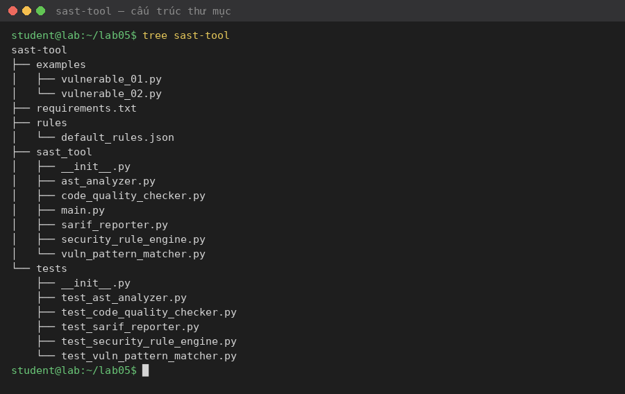

| Module | Vai trò | Kỹ thuật |
|---|---|---|
| `ast_analyzer.py` – **ASTAnalyzer** | Duyệt AST, phát hiện lời gọi `eval()` | Structural pattern |
| `vuln_pattern_matcher.py` – **VulnPatternMatcher** | Dùng regex tìm hardcoded password và `import pickle` | Literal pattern |
| `security_rule_engine.py` – **SecurityRuleEngine** | Đọc `rules/default_rules.json` và gán mức độ (high/medium/low) | Rule engine |
| `code_quality_checker.py` – **CodeQualityChecker** | Gọi `flake8` rồi chuẩn hoá lỗi lint | Code quality |
| `sarif_reporter.py` – **SarifReporter** | Xuất `report.sarif` | SARIF 2.1.0 |
| `main.py` | Điều phối toàn bộ pipeline | – |

**Luồng xử lý:**
1. `main.py` đọc file nguồn.
2. File được đưa qua `ASTAnalyzer` và `VulnPatternMatcher`. Kết quả của hai module này đi qua `SecurityRuleEngine` để gán severity.
3. Song song, `CodeQualityChecker` (flake8) quét file và cho ra các lỗi lint.
4. Tất cả được gộp lại và chuyển cho `SarifReporter`, đầu ra là `report.sarif`.

### 3.2 Cài đặt thư viện

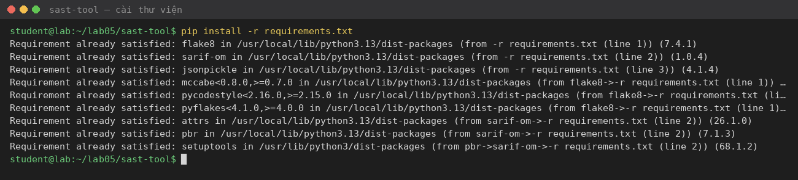

### 3.3 Chạy Unit Test

Kết quả: **6/6 test pass**.

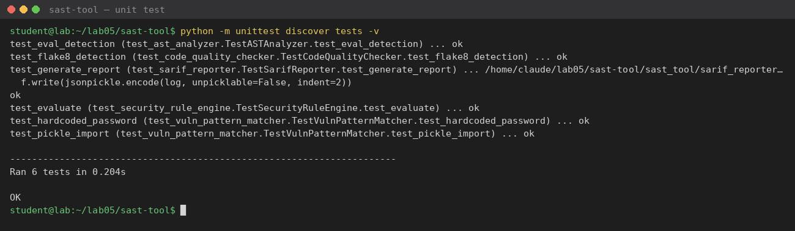

### 3.4 Kiểm tra file `vulnerable_01.py`

Công cụ phát hiện **8 issue**:

| # | Loại | Mức độ | Nội dung |
|---|---|---|---|
| 1 | Use of eval | high | `eval(data)` ở dòng 6 |
| 2 | Pattern Match | medium | Hardcoded password (gán chuỗi "123456" cho biến password) |
| 3 | Pattern Match | medium | `import pickle` |
| 4–8 | Lint Issue | – | F401, E402, E302 (2 lỗi), E305 |

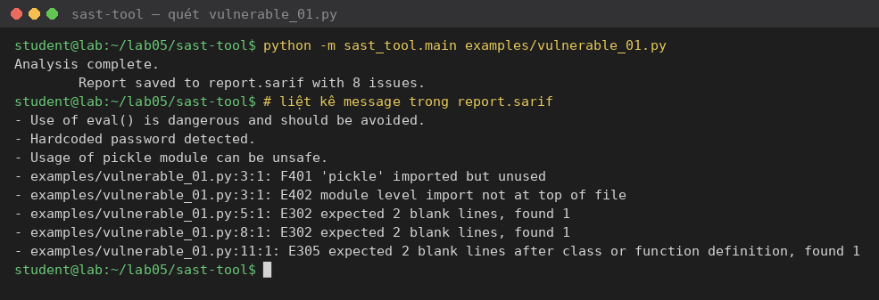

Nội dung file `report.sarif`:

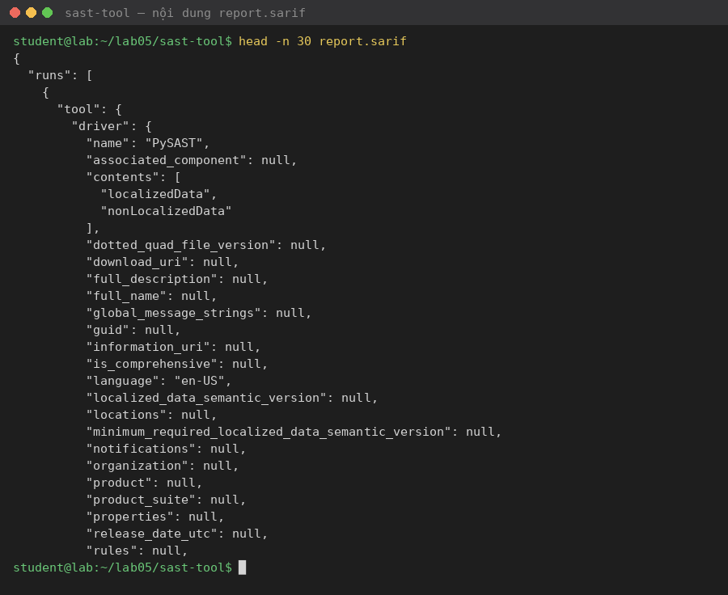

Xem bằng extension **SARIF Viewer** trong VS Code:

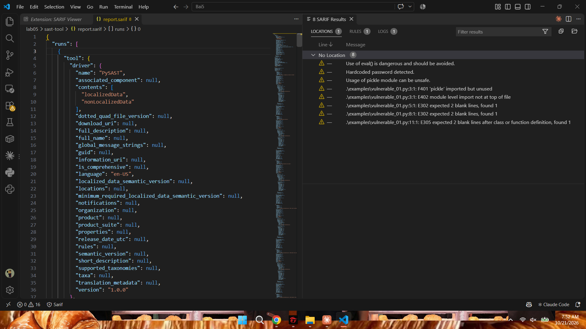

### 3.5 Kiểm tra file `vulnerable_02.py`

Công cụ phát hiện **4 issue**: 1 lỗi `eval` và 3 lỗi lint (E302 ×2, E305).

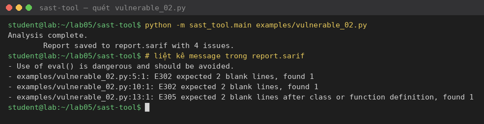

> **Nhận xét:** lời gọi `exec(code)` ở dòng 11 **không bị phát hiện** (false negative). Nguyên nhân là `ASTAnalyzer` chỉ kiểm tra tên hàm `eval`.

### 3.6 Commit với GitSecure

Lần commit đầu bị **GitSecure chặn**, vì hook phát hiện mật khẩu hardcode trong `vulnerable_01.py` và `test_vuln_pattern_matcher.py`:

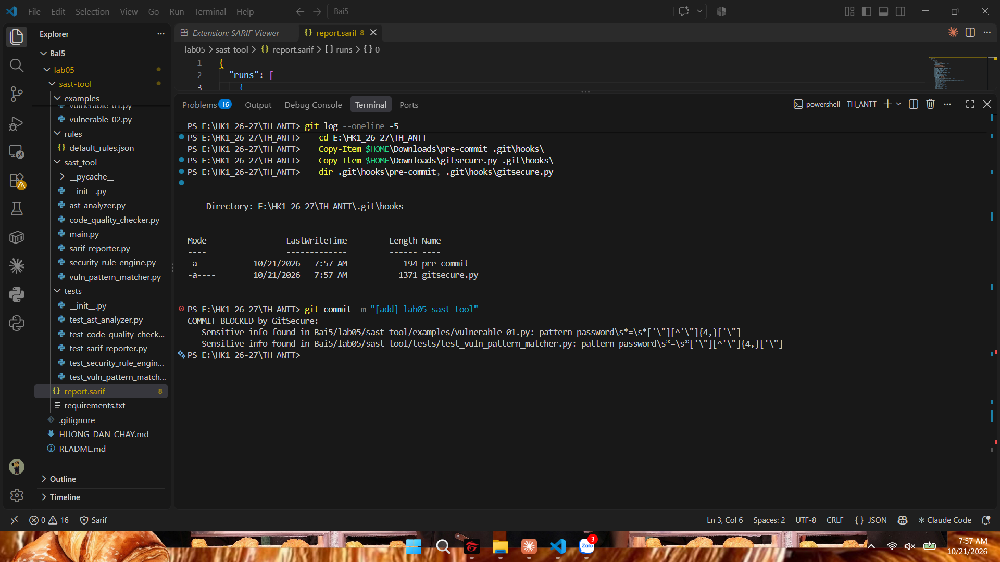

Sau khi thay chuỗi nhạy cảm thành giá trị ngắn (`"abc"`, dưới ngưỡng `{4,}` ký tự của hook), commit lại thành công và push lên remote:

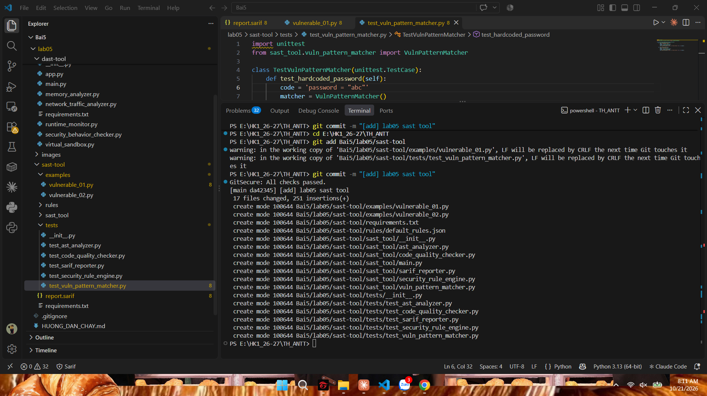

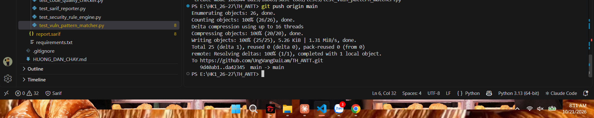

---

## 4. Thực hành DAST-TOOL

### 4.1 Cấu trúc thư mục

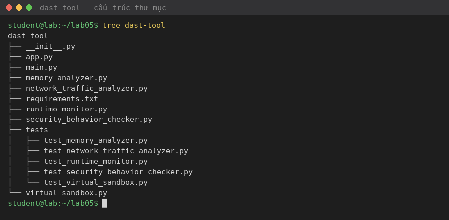

| Module | Vai trò |
|---|---|
| `runtime_monitor.py` – **RuntimeMonitor** | Lấy CPU %, RSS memory, danh sách file đang mở của một PID (dùng `psutil`) |
| `memory_analyzer.py` – **MemoryAnalyzer** | Kiểm tra `gc.garbage` (leak) và mô phỏng tràn số int64 |
| `network_traffic_analyzer.py` – **NetworkTrafficAnalyzer** | Thống kê bytes/packets theo từng card mạng |
| `security_behavior_checker.py` – **SecurityBehaviorChecker** | Tìm chuỗi `os.system`, `eval`, `exec` |
| `virtual_sandbox.py` – **VirtualSandbox** | Chạy lệnh trong thư mục tạm |
| `main.py` | Chạy toàn bộ module trên chính tiến trình hiện tại |
| `app.py` | REST API (Flask) với 5 endpoint |

### 4.2 Cài đặt thư viện

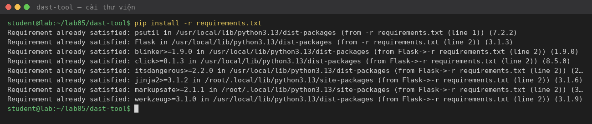

### 4.3 Chạy Unit Test

Kết quả: **5/5 test pass**.

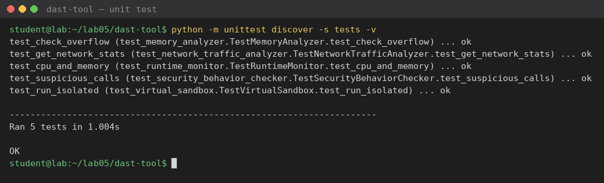

### 4.4 Chạy `main.py`

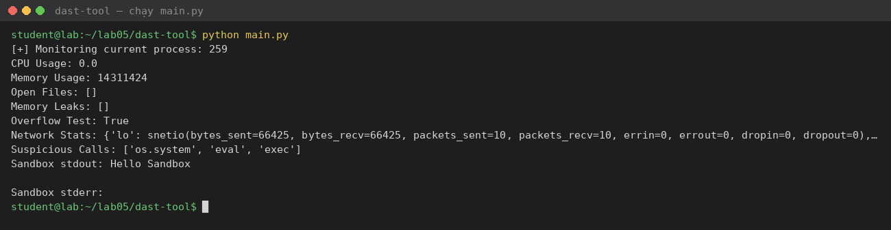

### 4.5 Giám sát qua Flask API

Khởi động server:

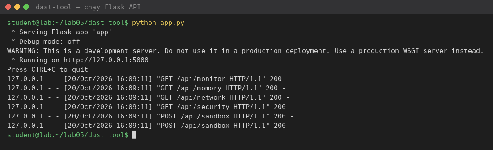

Gọi lần lượt các endpoint:

| Endpoint | Method | Kết quả |
|---|---|---|
| `/api/monitor` | GET | CPU, RAM, file đang mở |
| `/api/memory` | GET | `memory_leaks: []`, `overflow_test: true` |
| `/api/network` | GET | Thống kê từng card mạng |
| `/api/security` | GET | `["os.system","eval","exec"]` |
| `/api/sandbox` | POST | Kết quả chạy lệnh `echo hello`, `whoami` |

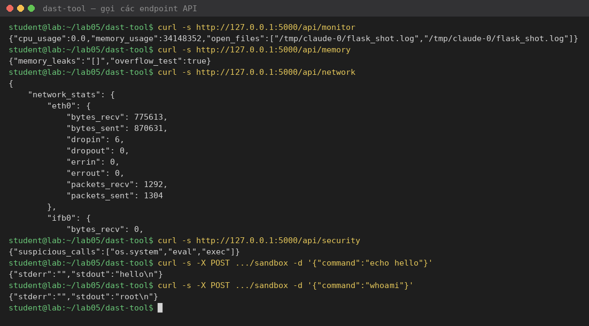

### 4.6 Commit và push

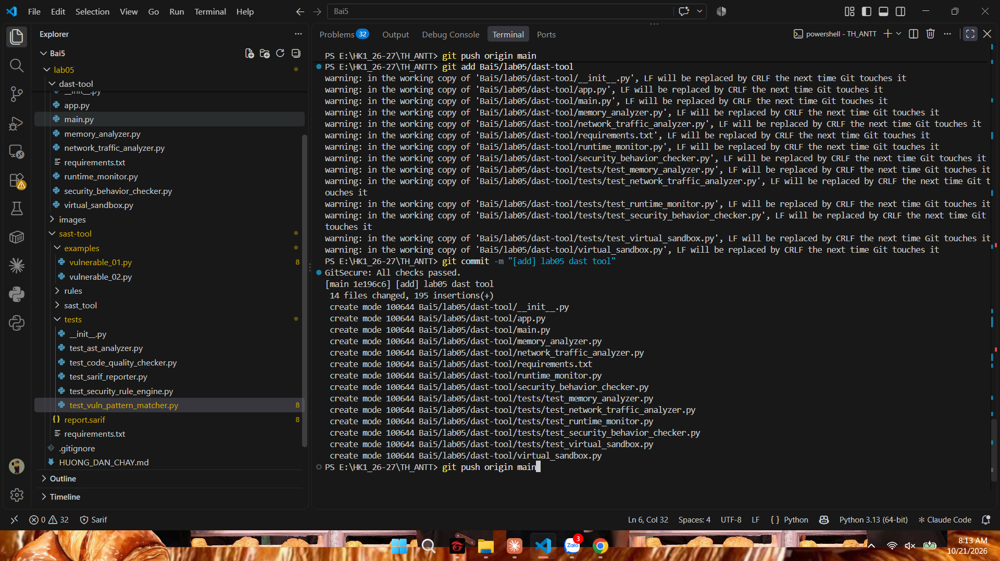

---

## 5. Nhận xét và đánh giá

### 5.1 SAST-TOOL

| # | Hạn chế | Ảnh hưởng |
|---|---|---|
| 1 | `ASTAnalyzer` chỉ bắt `eval`, bỏ sót `exec`, `os.system`, `subprocess(..., shell=True)`, `pickle.loads` | False negative: `exec` trong `vulnerable_02.py` không được báo |
| 2 | `VulnPatternMatcher` dùng regex trên text thô | False positive với chuỗi trong comment hoặc docstring. Bỏ sót `pwd = "..."` hay `PASSWORD="..."` (phân biệt hoa thường) |
| 3 | `SecurityRuleEngine` so khớp kiểu chuỗi con (`in`) | Một issue khớp nhiều rule sẽ bị thêm trùng nhiều lần |
| 4 | `SarifReporter` dùng `jsonpickle`, xuất tên thuộc tính dạng snake_case (`physical_location`, `start_line`) thay vì camelCase theo chuẩn SARIF | SARIF Viewer hiển thị **"No Location"**, không nhảy được tới dòng lỗi. Thiếu `ruleId` và `level` |
| 5 | `CodeQualityChecker` tách output bằng `split(":")` | Với đường dẫn tuyệt đối trên Windows (`C:\...`), mọi lỗi lint bị bỏ qua mà không báo |
| 6 | `test_code_quality_checker` dùng `NamedTemporaryFile(delete=True)` | Trên Windows flake8 không mở được file tạm, test vẫn pass nhờ `or len(issues)==0`, nên test không có giá trị kiểm chứng |
| 7 | Chỉ phân tích từng file đơn lẻ | Không có taint analysis (theo dõi dữ liệu từ nguồn `input()` tới điểm `eval`) |

### 5.2 DAST-TOOL

| # | Thành phần | Thực tế |
|---|---|---|
| 1 | `MemoryAnalyzer.check_memory_leaks` | Từ Python 3.4 (PEP 442), object có `__del__` vẫn được thu gom, nên `gc.garbage` hầu như luôn rỗng. Kết quả `[]` không chứng minh là không có leak |
| 2 | `MemoryAnalyzer.check_overflow` | Kiểu `int` của Python không tràn. Đây chỉ là mô phỏng giới hạn int64, và còn bỏ sót đúng giá trị `2**63` (dùng `>` thay vì `>=`) |
| 3 | `SecurityBehaviorChecker` | Đọc chính file nguồn của nó (`__file__`), nên luôn trả về `['os.system','eval','exec']`. Bản chất đây là phân tích tĩnh, không phải giám sát hành vi runtime |
| 4 | `VirtualSandbox` | Chỉ đổi thư mục làm việc và chạy với `shell=True`. **Không có cách ly**: lệnh `whoami` trả về user thật của hệ thống |
| 5 | `app.py` `/api/sandbox` | **Lỗ hổng Remote Code Execution (CWE-78)**. Lệnh từ request được chạy trực tiếp, không xác thực. Bản gốc lắng nghe `0.0.0.0` nên mọi máy trong mạng LAN đều khai thác được. Trong bài này đã đổi thành `127.0.0.1` |
| 6 | `NetworkTrafficAnalyzer` | Chỉ là counter tổng của card mạng, không phân tích kết nối, domain hay payload theo tiến trình |
| 7 | `RuntimeMonitor.get_cpu_usage` | `interval=1.0` chặn 1 giây cho mỗi lần gọi API |

> **Kết luận đánh giá:** công cụ minh hoạ đúng kiến trúc của một nền tảng SAST/DAST, nhưng nhiều thành phần mới ở mức mô phỏng. Đáng chú ý nhất, chính công cụ kiểm thử bảo mật lại chứa lỗ hổng RCE. Đây là ví dụ cho thấy công cụ bảo mật cũng cần được kiểm thử bảo mật.

### 5.3 So sánh SAST và DAST

| Tiêu chí | SAST | DAST / Runtime |
|---|---|---|
| Đầu vào | Mã nguồn | Ứng dụng đang chạy |
| Thời điểm | Sớm (khi code, CI) | Sau khi build hoặc deploy |
| Ưu điểm | Chỉ ra đúng dòng lỗi, không cần chạy | Phát hiện lỗi cấu hình, lỗi runtime, ít false positive |
| Nhược điểm | Nhiều false positive, không thấy lỗi môi trường | Không chỉ ra dòng code, độ phủ phụ thuộc kịch bản chạy |
| Ví dụ trong bài | Phát hiện `eval` và hardcoded password | Phát hiện `/api/sandbox` thực thi `whoami` |

Hai phương pháp **bổ sung cho nhau**: SAST của bài không phát hiện được `shell=True` trong `virtual_sandbox.py`, nhưng khi chạy thử API thì lỗ hổng lộ ra ngay.

---

## 6. Đề xuất cải tiến

1. **Mở rộng ASTAnalyzer**: đưa danh sách hàm nguy hiểm (`eval`, `exec`, `os.system`, `pickle.loads`, `yaml.load`, `subprocess.*` có `shell=True`) vào file rule JSON, để thêm rule mà không phải sửa code.
2. **Viết lại SarifReporter bằng `json` thuần**, theo đúng schema camelCase, có thêm `ruleId`, `level` (error/warning/note) và `$schema`. Khi đó SARIF Viewer hiển thị đúng vị trí lỗi.
3. **Taint analysis đơn giản**: theo dõi biến được gán từ `input()`, `request.args`, `sys.argv` và cảnh báo khi biến đó đi vào sink như `eval` hay `os.system`.
4. **Giám sát runtime thật bằng audit hook (PEP 578)**:
   ```python
   import sys
   def hook(event, args):
       if event in ("exec", "os.system", "subprocess.Popen"):
           print(f"[ALERT] {event}: {args[0]!r}")
   sys.addaudithook(hook)
   ```
5. **Sandbox thật**: chạy lệnh trong Docker container (`--network none --read-only --user nobody`, giới hạn CPU/RAM). Bỏ `shell=True`, dùng whitelist lệnh, và thêm xác thực cho API.
6. **Tích hợp CI/CD**: chạy sast-tool trong GitHub Actions và upload `report.sarif` lên GitHub Code Scanning.

---

## 7. Kết luận

Qua bài thực hành, em đã xây dựng được:
- Một công cụ SAST cho Python, gồm 5 thành phần và xuất báo cáo SARIF. Công cụ phát hiện đúng 8 và 4 issue trên hai file mẫu, 6/6 unit test pass.
- Một nền tảng giám sát runtime, gồm 5 thành phần và REST API Flask. 5/5 unit test pass, các endpoint hoạt động đúng.
- Quy trình commit có kiểm soát bằng hook GitSecure, giúp ngăn đẩy thông tin nhạy cảm lên repo.

Bài thực hành cũng cho thấy giới hạn của từng phương pháp và sự cần thiết phải kết hợp SAST với DAST trong quy trình phát triển phần mềm an toàn (Secure SDLC).
