# BÁO CÁO BÀI THỰC HÀNH 6: BẢO MẬT VỚI DEVSECOPS

| | |
|---|---|
| **Họ và tên** | `Ung Văng Đại Lâm` |
| **MSSV** | `2380601202` |
| **Lớp / Học phần** | `23DATA1` – Lập trình an toàn thông tin |
| **Repo** | `https://github.com/UngVangDaiLam/TH_ANTT` |
| **Nội dung** | Thực hành CI/CD với GitLab (mục 6.2 của đề bài) |

---

## 1. Mục tiêu

- Hiểu cách tích hợp bảo mật vào pipeline CI/CD (DevSecOps).
- Biết cấu trúc tệp `.gitlab-ci.yml`: `stages`, `jobs`, `script`, `image`, `artifacts`.
- Tạo và chạy pipeline đầu tiên trên GitLab.
- Xây dựng pipeline phức tạp hơn: build trang Docusaurus và triển khai lên GitLab Pages.

## 2. Cơ sở lý thuyết (tóm tắt mục 6.1)

**Pipeline CI/CD an toàn** cần có các thành phần:

| Thành phần | Ý nghĩa |
|---|---|
| Access Control | Bật MFA, phân quyền theo nguyên tắc ít quyền nhất |
| Secrets Management | Không ghi khóa API/mật khẩu vào mã nguồn, dùng kho bí mật (Vault, AWS Secrets Manager), quét rò rỉ bằng truffleHog |
| Code Signing & Integrity | Commit và artifact phải được ký để xác minh toàn vẹn |
| Security Gates | SAST, Dependency Scanning, DAST là các “cửa chắn” bắt buộc; lỗi nghiêm trọng thì pipeline dừng |
| Monitoring & Auditing | Ghi log mỗi lần chạy, cảnh báo hành vi bất thường |
| Bảo vệ CI/CD runner | Cô lập runner, cập nhật thường xuyên, hạn chế truy cập mạng |

**Kiểm thử bảo mật tự động** (Shift Left Security): SAST, DAST, SCA (Software Composition Analysis), Secret Scanning.

**Bảo mật IaC**: kiểm tra cấu hình Terraform/Ansible/CloudFormation, phát hiện lỗ hổng sớm, tự động quét trong pipeline.

## 3. Môi trường

- Tài khoản GitLab.com (runner dùng chung do GitLab cung cấp)
- Git, Node.js (v22), npm (v10)
- Docusaurus (template `classic`)

---

## 4. Thực hành

### 4.1. Tạo và chạy pipeline đầu tiên (mục 6.2.1)

**Bước 1.** Đăng nhập GitLab.com, tạo dự án trống, kiểm tra runner ở **Settings > CI/CD > Runners** (có vòng tròn xanh là runner sẵn sàng).

> 📷 `images/01_runner.png` – Danh sách runner khả dụng
>
> 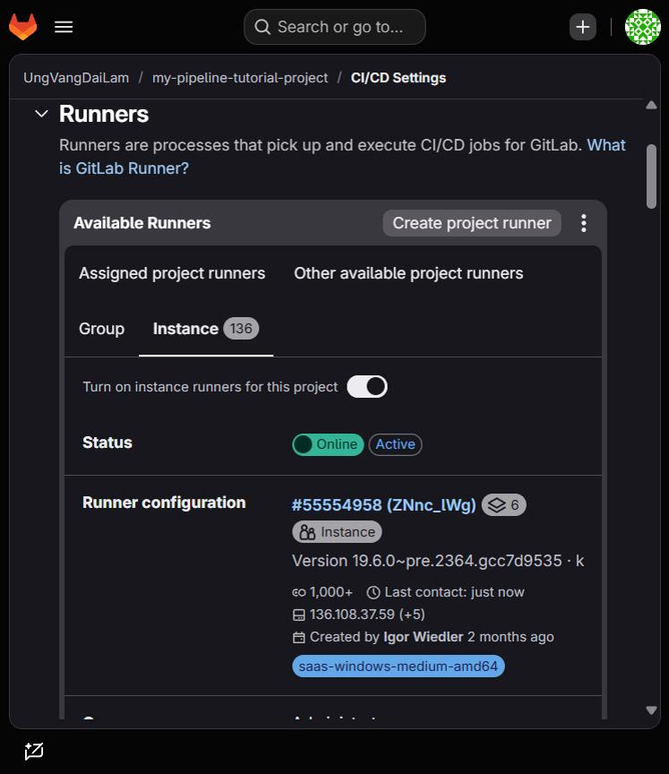

**Bước 2.** Tại **Code > Repository**, chọn nhánh `main`, tạo tệp mới `.gitlab-ci.yml` với nội dung:

```yaml
build-job:
  stage: build
  script:
    - echo "Hello, $GITLAB_USER_LOGIN!"

test-job1:
  stage: test
  script:
    - echo "This job tests something"

test-job2:
  stage: test
  script:
    - echo "This job tests something, but takes more time than test-job1."
    - echo "After the echo commands complete, it runs the sleep command for 20 seconds"
    - echo "which simulates a test that runs 20 seconds longer than test-job1"
    - sleep 20

deploy-prod:
  stage: deploy
  script:
    - echo "This job deploys something from the $CI_COMMIT_BRANCH branch."
  environment: production
```

> 📷 `images/02_tao_gitlab_ci.png` – Tạo tệp `.gitlab-ci.yml` trên giao diện GitLab
>
> 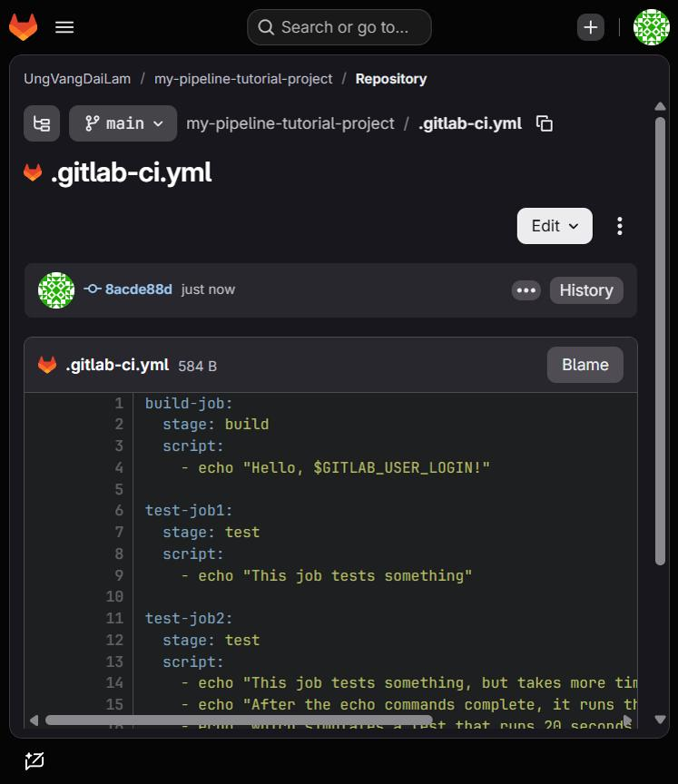

**Bước 3.** Chọn **Commit changes**. Pipeline tự động chạy.

**Bước 4.** Vào **Build > Pipelines** để xem trạng thái, bấm vào ID pipeline để xem sơ đồ 3 giai đoạn `build → test → deploy`.

> 📷 `images/03_pipeline_list.png` – Danh sách pipeline
>
> 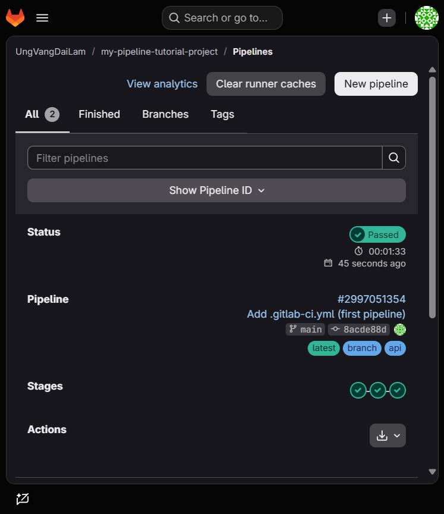
>
> 📷 `images/04_pipeline_graph.png` – Sơ đồ pipeline (build / test / deploy)
>
> 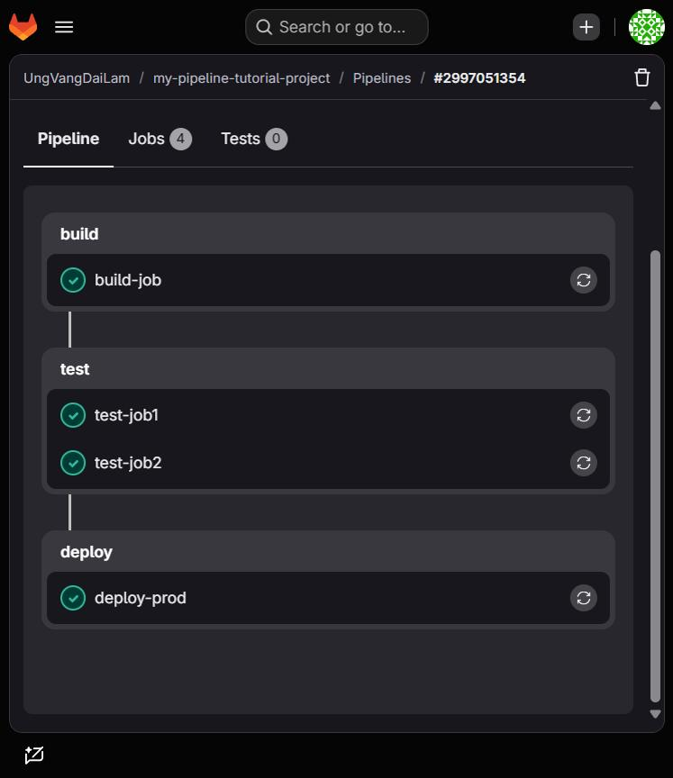

**Bước 5.** Bấm vào job `deploy-prod` để xem log.

> 📷 `images/05_job_log.png` – Log của job `deploy-prod`
>
> 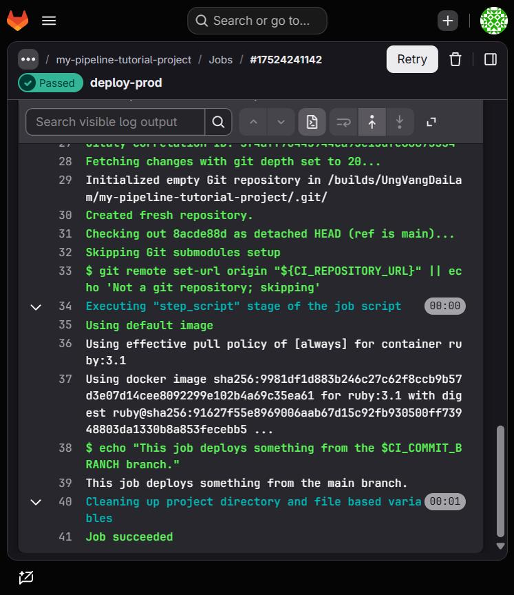

**Giải thích:**

- Có 4 job: `build-job`, `test-job1`, `test-job2`, `deploy-prod`, thuộc 3 stage `build`, `test`, `deploy`.
- `test-job1` và `test-job2` cùng stage `test` nên chạy song song; stage `deploy` chỉ chạy khi stage `test` thành công.
- `$GITLAB_USER_LOGIN` và `$CI_COMMIT_BRANCH` là biến định nghĩa sẵn, được GitLab điền giá trị lúc job chạy.

### 4.2. Tạo pipeline CI/CD phức tạp – Docusaurus + GitLab Pages (mục 6.2.2)

#### 4.2.1. Tạo dự án và clone về máy

Tạo dự án mới **My Pipeline Tutorial Project** (dự án trống, có README), sau đó clone:

```bash
git clone git@gitlab.com:<username>/my-pipeline-tutorial-project.git pipeline-tutorial
cd pipeline-tutorial
```

> 📷 `images/06_tao_du_an.png` – Tạo dự án trên GitLab
>
> 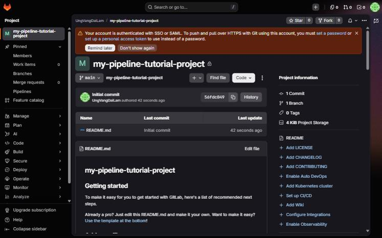

#### 4.2.2. Khởi tạo trang Docusaurus

```bash
npm init docusaurus
```

Chọn toàn bộ tùy chọn mặc định (template `classic`). Trình hướng dẫn tạo site trong thư mục `website/`, nhưng site phải nằm ở thư mục gốc dự án nên di chuyển lên:

```bash
mv website/* .
rm -r website
```

> 📷 `images/07_init_docusaurus.png` – Khởi tạo Docusaurus
>
> 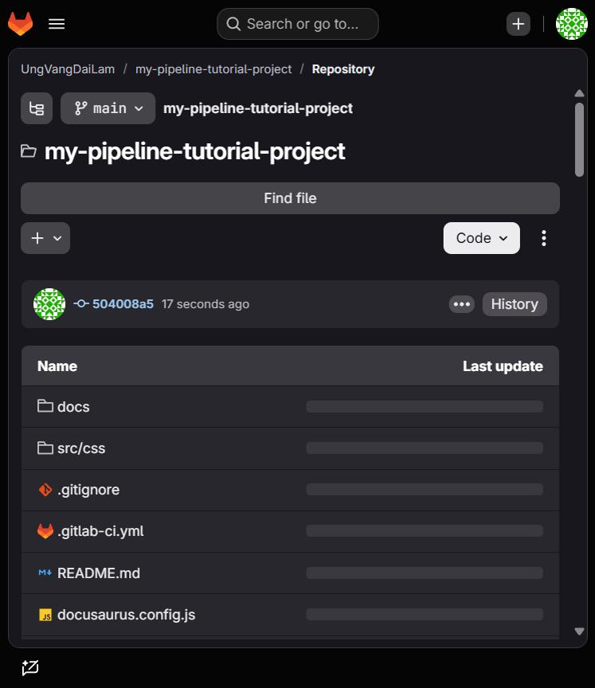

#### 4.2.3. Cập nhật cấu hình `docusaurus.config.js` (hoặc `.ts`)

```js
url: 'https://<username>.gitlab.io',
baseUrl: '/my-pipeline-tutorial-project/',
```

> 📷 `images/08_config.png` – Cấu hình `url` và `baseUrl`
>
> 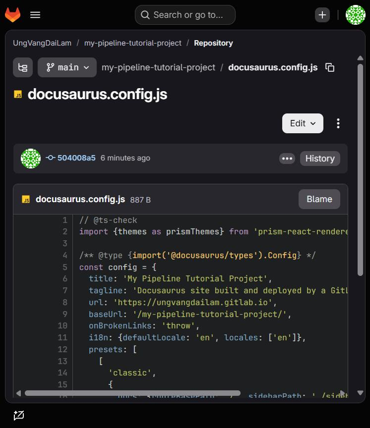

Commit và đẩy lên GitLab:

```bash
git add .
git commit -m "Add simple generated Docusaurus site"
git push origin
```

#### 4.2.4. Tạo cấu hình CI/CD ban đầu

Tạo `.gitlab-ci.yml` đơn giản nhất để kiểm tra runner hoạt động:

```yaml
test-job:
  script:
    - echo "This is my first job!"
    - date
```

Commit, vào **Build > Pipelines**, mở job để xem dòng `This is my first job!` cùng ngày giờ hiện tại.

> 📷 `images/09_test_job.png` – Log của `test-job`
>
> 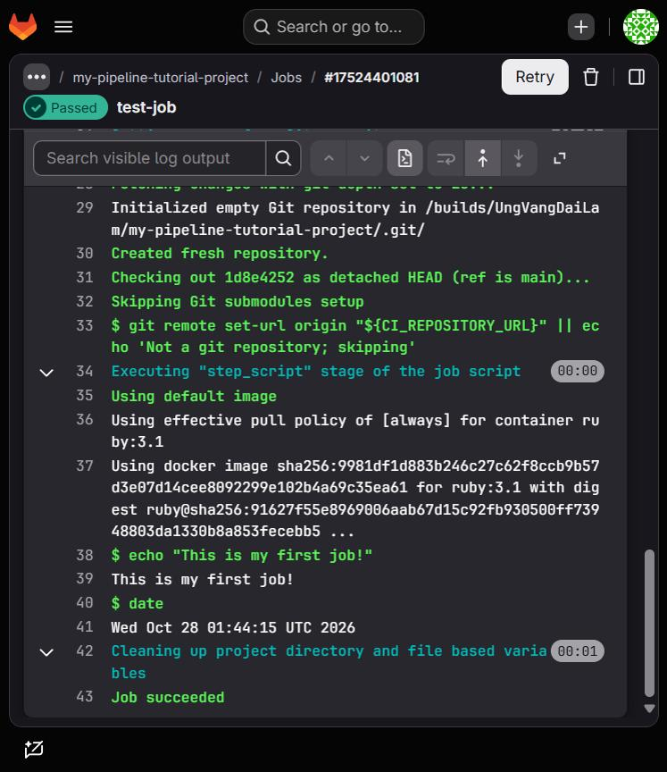

#### 4.2.5. Thêm job build trang web

Thay `test-job` bằng `build-job`:

```yaml
build-job:
  image: node
  script:
    - npm install
    - npm run build
  artifacts:
    paths:
      - "build/"
```

- `image: node`: runner tải image Node.js, clone dự án vào container rồi chạy từng lệnh trong `script`.
- `artifacts`: lưu thư mục `build/` để job sau dùng lại (các job chạy độc lập, không chia sẻ tài nguyên).

Kiểm tra: xem log `npm install`, `npm run build`; bấm **Browse** bên phải log để duyệt nội dung artifacts.

> 📷 `images/10_build_job.png` – Log của `build-job` (build thành công)
>
> 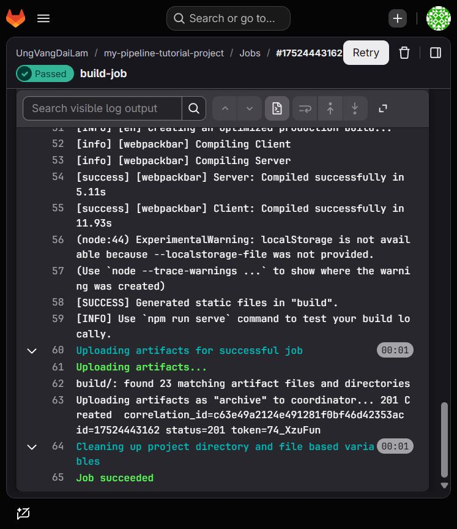
>
> 📷 `images/11_artifacts.png` – Duyệt artifacts `build/`
>
> 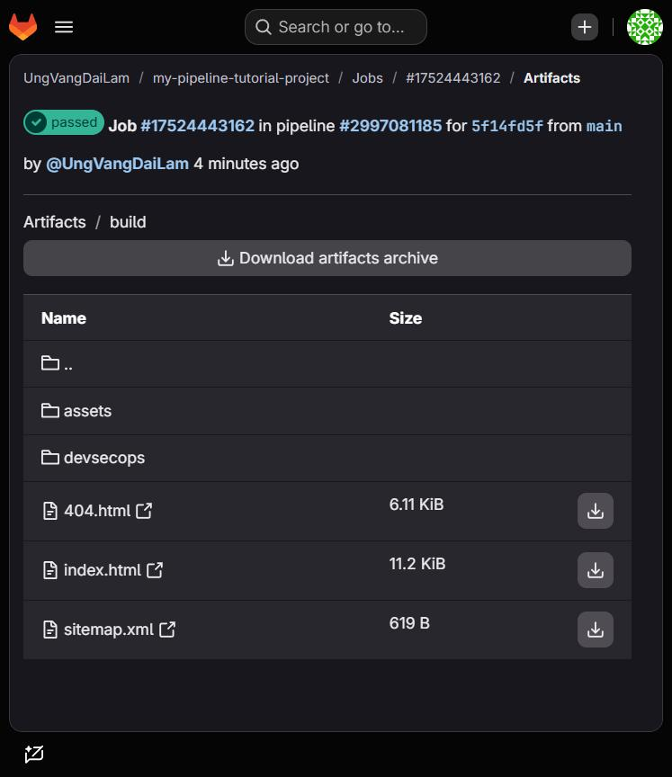

#### 4.2.6. Thêm job triển khai lên GitLab Pages

Cấu hình `.gitlab-ci.yml` hoàn chỉnh (cũng là tệp có trong thư mục này):

```yaml
stages:
  - build
  - deploy

build-job:
  stage: build
  image: node
  script:
    - npm install
    - npm run build
  artifacts:
    paths:
      - "build/"

pages:
  stage: deploy
  script:
    - mv build/ public/
  artifacts:
    paths:
      - "public/"
```

- Job triển khai Pages **bắt buộc tên là `pages`**.
- Artifacts của `build-job` được tự động tải về và giải nén trong job `pages`.
- GitLab Pages đọc site từ thư mục `public/`, nên cần `mv build/ public/`.
- `stages` xác định thứ tự: `build-job` (stage `build`) chạy trước, `pages` (stage `deploy`) chạy sau.

> 📷 `images/12_pipeline_2_stage.png` – Pipeline 2 stage `build` và `deploy`
>
> 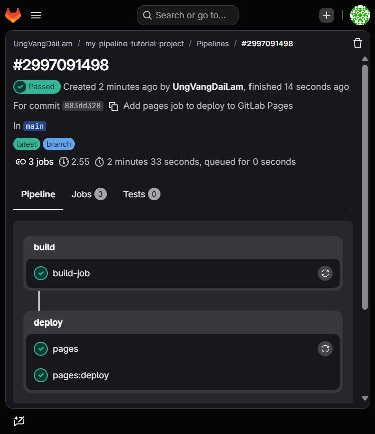
>
> 📷 `images/13_pages_deploy.png` – Job `pages` và `pages:deploy` hoàn tất
>
> 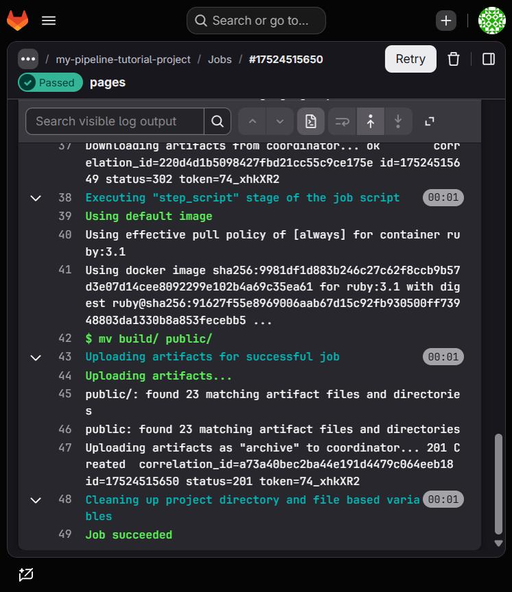

#### 4.2.7. Xem trang web

Vào **Deploy > Pages**, tắt **Use unique domain** (nếu có), mở liên kết ở mục **Access pages**:

```
https://<username>.gitlab.io/my-pipeline-tutorial-project
```

> 📷 `images/14_pages_settings.png` – Cài đặt GitLab Pages
>
> 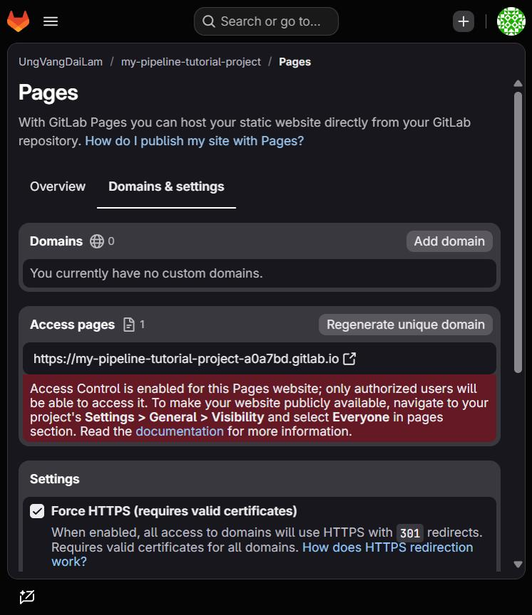
>
> 📷 `images/15_website.png` – Trang Docusaurus sau khi triển khai
>
> 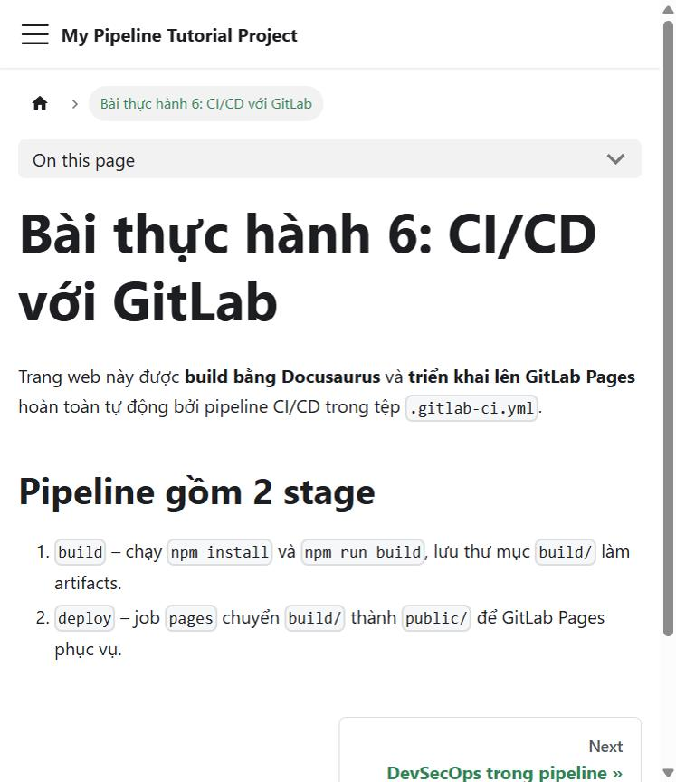

---

## 5. Liên hệ với DevSecOps

Pipeline trong bài mới có hai stage `build` và `deploy`. Để đạt mức DevSecOps như mục 6.1, có thể bổ sung một stage `test` chứa các “cửa chắn” bảo mật trước `deploy`, ví dụ dùng template có sẵn của GitLab:

```yaml
include:
  - template: Security/SAST.gitlab-ci.yml
  - template: Security/Secret-Detection.gitlab-ci.yml
  - template: Security/Dependency-Scanning.gitlab-ci.yml
```

Khi các job quét phát hiện lỗi nghiêm trọng, pipeline dừng và thông báo cho developer, giúp phát hiện lỗi sớm (Shift Left) trước khi triển khai ra môi trường thật. (Một số tính năng quét phụ thuộc gói GitLab đang dùng.)

## 6. Kết luận

- Đã tạo và chạy thành công pipeline CI/CD đầu tiên với 4 job, 3 stage.
- Đã dựng pipeline build trang Docusaurus và triển khai lên GitLab Pages bằng `.gitlab-ci.yml`.
- Nắm được vai trò của `stages`, `jobs`, `image`, `artifacts` và cách các job chia sẻ dữ liệu qua artifacts.
- Hiểu cách đặt các chốt kiểm tra bảo mật (SAST, SCA, Secret Detection) vào pipeline để hiện thực hóa DevSecOps.

## 7. Cấu trúc thư mục

```
Bai6/
├── .gitlab-ci.yml          # pipeline build + deploy GitLab Pages
├── docusaurus.config.ts    # url, baseUrl đã cập nhật
├── docs/ blog/ src/ static/ sidebars.ts package.json
├── images/                 # ảnh chụp màn hình dùng trong báo cáo
└── README.md               # báo cáo này
```
